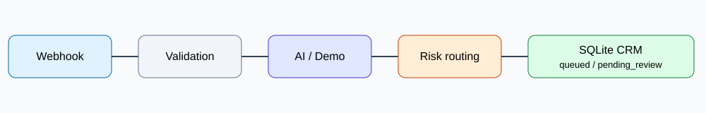

# AI Support Triage Agent – Google Gemini + n8n

Portfolio projekt: automatické třídění zákaznických zpráv pomocí skutečného LLM (Google Gemini API), bezpečnostních pravidel, lidské kontroly a evidence v lokálním mock CRM (Python + SQLite). Používá pouze syntetická testovací data.

## Architektura

`POST /webhook/ai-support-live` → `Validate input` → `Valid request?` → `Gemini classify` → `Parse AI result` → `Security Guard` → `Human review required?` → `Mark for review` / `Mark routine` → `Store ticket` → `Reply to caller`.

Při neplatném vstupu vede větev `Valid request?` na uzel `Validation error` (HTTP 400). Návrh odpovědi se ukládá jako koncept, **neodesílá se zákazníkovi**. `Security Guard` je pouze omezená pravidlová ochrana pro vybrané typy incidentů; **nezaručuje obecnou odolnost vůči prompt injection**.



## Požadavky

- Windows 11 / macOS / Linux s Docker Desktop nebo Docker Engine + Compose pluginem
- Pro automatické Bash testy: Bash, `curl` a Python 3 (standard library)
- Google Gemini API klíč (bezplatná kvóta závisí na účtu a regionu)
- Pro lokální reprodukovatelnost jsou image verze připnuté v `docker-compose.yml`; dostupnost tagů a Docker spuštění je nutné ověřit na cílovém počítači.

## Spuštění

1. Ve složce projektu spusťte `docker compose pull && docker compose up -d`.
2. Otevřete n8n: <http://localhost:5678> a vytvořte lokální účet.
3. Importujte `workflows/ai-support-gemini.json` přes menu editoru **Import from File**.
4. V uzlu **Gemini classify** vytvořte / vyberte credential typu **Header Auth**: `Name = x-goog-api-key`, `Value = <vlastní Gemini API klíč>`.
5. V uzlu **Gemini classify** ověřte URL modelu. Export používá `gemini-3.5-flash-lite:generateContent`.
6. Uložte a publikujte workflow. Nepublikujte současně jiné workflow se stejnou webhook cestou.
7. Zkontrolujte <http://localhost:8000/health> a <http://localhost:8000/tickets>.
8. Spusťte `bash run_tests.sh`. Skript automaticky vytváří unikátní `request_id` a porovnává výsledek s CRM.

Production webhook: `http://localhost:5678/webhook/ai-support-live`.

Testovací webhook `http://localhost:5678/webhook-test/ai-support-live` funguje pouze během čekání na testovací událost v editoru n8n.

## Automatické regresní testy

```bash
bash run_tests.sh
```

Volitelné proměnné `WEBHOOK_URL` a `CRM_URL` umožňují změnit cílové lokální adresy. Testy v `scripts/e2e_check.py` využívají jen standardní knihovnu Pythonu. Každý pozitivní test získá nové ID, duplicitní test znovu odešle ID vytvořeného ticketu. Testy kontrolují HTTP odpověď a obsah mock CRM; konečné skóre se vypíše jako `PASS` / `FAIL` a neúspěch vrátí nenulový exit code.

> Poznámka: Protože n8n při selhání uzlu `Store ticket` může vrátit volajícímu HTTP 500 namísto původního 409 z CRM, duplicitní scénář vyhodnocujeme hlavně podle toho, že se nezaložil druhý ticket. Taková odpověď HTTP 500 zůstává nedostatkem API ergonomie a měla by se později opravit.

Samostatné unit testy mock CRM:

```bash
python -m unittest discover -s tests -v
```

Dokumentace scénářů: [docs/test-plan.md](docs/test-plan.md).

## Bezpečnost a limity

- Ve veřejném workflow nejsou credentials ani interní ID instance. Po importu je třeba znovu vybrat vlastní credential.
- Mock CRM a n8n poslouchají na `127.0.0.1`; nejedná se o produkční, autentizovanou veřejnou službu.
- Skript používá pouze syntetické příklady a čte lokální testovací databázi.
- LLM může chybně klasifikovat nebo formulovat nepodložené tvrzení v `draft_reply`; **návrhy neodesílejte automaticky**.
- Ochrana `Security Guard` je částečná a testy prokazují pouze chování na zvolených příkladech.

## Použité technologie

n8n, Google Gemini API, JavaScript (n8n Code), Python 3, SQLite, Docker Compose, Bash.

## Licence

Vlastní kód a dokumentace tohoto repozitáře jsou licencovány pod [MIT License](LICENSE). n8n a ostatní závislosti podléhají vlastním licencím.
